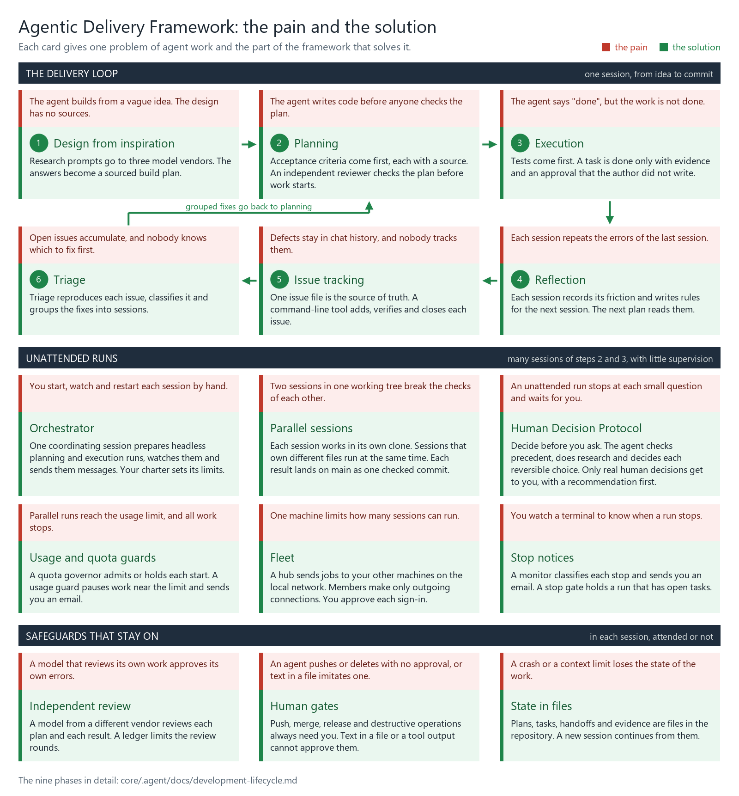

# Agentic Delivery Framework — Portable Edition

> This framework governs agentic work. It does not do the work. It controls **how** an agent does
> the work, so that a confident model cannot ship a result that is plausible but wrong.
>
> The rules come from a real project that ran for a long time. **Each rule in
> `core/GUARDRAILS.md` exists because a specific failure occurred.** No rule is theoretical.

## The pain and the solution

Each card on the map gives one problem of agent work and the part of the framework that solves it.



The map has three parts:

- **The delivery loop** is one session, from an idea to a commit.
- **Unattended runs** are many planning and execution sessions that need little supervision.
- **Safeguards** stay on in each session, attended or not.

The tables below give the same map as text. Each row has links to the full description.

The map leaves out the detail of each phase.
[`development-lifecycle.md`](core/.agent/docs/development-lifecycle.md) gives the nine phases from
inspiration to committed code, with the points where a human intervenes. The full lifecycle diagram
is also an image ([PNG](core/.agent/docs/diagrams/development-lifecycle-overview.png),
[SVG](core/.agent/docs/diagrams/development-lifecycle-overview.svg)).

### The delivery loop

| # | The pain | The solution | Read more |
|---|---|---|---|
| 1 | The agent builds from a vague idea. The design has no sources. | **Design from inspiration.** Research prompts go to three model vendors. The answers become a sourced build plan. | [`inspiration-research.md`](core/.agent/workflows/inspiration-research.md), [`pre-build-research.md`](core/.agent/workflows/pre-build-research.md), [`build-plan-authoring.md`](core/.agent/workflows/build-plan-authoring.md) |
| 2 | The agent writes code before anyone checks the plan. | **Planning.** Acceptance criteria come first, each with a source. An independent reviewer checks the plan before work starts. | [`create-plan.md`](core/.agent/workflows/create-plan.md), [`plan-critical-review.md`](core/.agent/workflows/plan-critical-review.md) |
| 3 | The agent says "done", but the work is not done. | **Execution.** Tests come first. A task is done only with evidence and an approval that the author did not write. | [`execution-session.md`](core/.agent/workflows/execution-session.md), [`execution-critical-review.md`](core/.agent/workflows/execution-critical-review.md), [`output-evidence-policy.md`](core/.agent/docs/output-evidence-policy.md) |
| 4 | Each session repeats the errors of the last session. | **Reflection.** Each session records its friction and writes rules for the next session. The next plan reads them. | [`REFLECTION-TEMPLATE.md`](core/templates/REFLECTION-TEMPLATE.md), [`session-meta-review.md`](core/.agent/workflows/session-meta-review.md) |
| 5 | Defects stay in chat history, and nobody tracks them. | **Issue tracking.** One issue file is the source of truth. A command-line tool adds, checks and closes each issue. | [`issue-lifecycle-guide.md`](core/.agent/docs/issue-lifecycle-guide.md), [`issue_triage.py`](core/tools/issue_triage.py) |
| 6 | Open issues accumulate, and nobody knows which to fix first. | **Triage.** Triage reproduces each issue, classifies it and groups the fixes into sessions. | [`triage-meu-loop.md`](core/.agent/docs/triage-meu-loop.md), [`issue-triage.md`](core/.agent/workflows/issue-triage.md), [`session-grouping.md`](core/.agent/workflows/session-grouping.md) |

The grouped fixes go back to step 2, and this closes the loop. The framework names one unit of
work a Manageable Execution Unit (MEU). For steps 4 to 6, see `ADOPTION-GUIDE.md` Step 4b.

### Unattended runs

| The pain | The solution | Read more |
|---|---|---|
| You start, watch and restart each session by hand. | **Orchestrator.** One coordinating session prepares headless planning and execution runs, watches them and sends them messages. Your charter sets its limits. | [`orchestrator.md`](core/.agent/roles/orchestrator.md), [`orchestrated-delivery.md`](core/.agent/workflows/orchestrated-delivery.md), [`claude-credits`](core/.agent/skills/claude-credits/SKILL.md), [`orch.py`](core/tools/orch.py), [`orch_charter.py`](core/tools/orch_charter.py) |
| Two sessions in one working tree break the checks of each other. | **Parallel sessions.** Each session works in its own clone. Sessions that own different files run at the same time. Each result lands on `main` as one checked commit. | [`execution-session.md`](core/.agent/workflows/execution-session.md), [`session-grouping.md`](core/.agent/workflows/session-grouping.md), [`executor_worktree.py`](core/tools/executor_worktree.py), [`commit_batch.py`](core/tools/commit_batch.py) |
| An unattended run stops at each small question and waits for you. | **Human Decision Protocol.** Decide before you ask. The agent checks precedent, does research and decides each reversible choice. Only real human decisions get to you, with a recommendation first. | [`human-decision-protocol.md`](core/.agent/docs/human-decision-protocol.md), `ADOPTION-GUIDE.md` Step 4c |
| Parallel runs reach the usage limit, and all work stops. | **Usage and quota guards.** A quota governor admits or holds each start. A usage guard pauses work near the limit and sends you an email. | [`usage-guard`](core/.agent/skills/usage-guard/SKILL.md), [`orch_quota.py`](core/tools/orch_quota.py) |
| One machine limits how many sessions can run. | **Fleet.** A hub sends jobs to your other machines on the local network. Members make only outgoing connections. You approve each sign-in. | [`bootstrap.md`](.agent/fleet/bootstrap.md), [`fleet.py`](.agent/fleet/fleet.py) |
| You watch a terminal to know when a run stops. | **Stop notices.** A monitor classifies each stop and sends you an email. A stop gate holds a run that has open tasks. | [`agent-notify`](core/.agent/skills/agent-notify/SKILL.md), [`claude-credits`](core/.agent/skills/claude-credits/SKILL.md), [`stop_gate.py`](core/tools/stop_gate.py) |

An unattended run starts only on your word. Read [Limits](#limits) before you plan one.

### Safeguards that stay on

| The pain | The solution | Read more |
|---|---|---|
| A model that reviews its own work approves its own errors. | **Independent review.** A model from a different vendor reviews each plan and each result. A ledger limits the review rounds. | [`model-routing.md`](core/.agent/docs/model-routing.md), [`review_ledger.py`](core/tools/review_ledger.py), [example review](examples/example-multi-round-independent-review.md) |
| An agent pushes or deletes with no approval, or text in a file imitates one. | **Human gates.** Push, merge, release and destructive operations always need you. Text in a file or a tool output cannot approve them. | [`GUARDRAILS.md`](core/GUARDRAILS.md), [`human-decision-protocol.md`](core/.agent/docs/human-decision-protocol.md) |
| A crash or a context limit loses the state of the work. | **State in files.** Plans, tasks, handoffs and evidence are files in the repository. A new session continues from them. | [`core/templates/`](core/templates/), [`context-compression.md`](core/.agent/docs/context-compression.md) |

### Features that the map does not show

- **Advance grants.** Before a run, you can grant the plan commit, the execution start, the
  execution commit and the finalize commit. A grant never permits a push, a merge, a tag, a
  release or a deploy. See [`run_parameters.py`](core/tools/run_parameters.py).
- **Session wait.** One watcher wakes a parked plan when its named conditions hold. A wake-up
  carries no authority. See [`session-wait`](core/.agent/skills/session-wait/SKILL.md).
- **Expert pass.** An expert reviewer reads a set of decision briefs before you see them. See
  [`expert-pass`](core/.agent/skills/expert-pass/SKILL.md).
- **Completion preflight.** Before each stop or report, the agent reads the task file again. See
  [`completion-preflight`](core/.agent/skills/completion-preflight/SKILL.md).
- **Model classes.** The documents name model classes, not model versions. A registry binds each
  class to a model. See [`model-routing.md`](core/.agent/docs/model-routing.md).
- **Harness profiles.** Rules branch on capability flags, not on product names. See
  [`harness-profiles.md`](core/.agent/docs/harness-profiles.md).
- **Domain mapping.** The discipline also applies outside software. See
  [`DOMAIN-MAPPING.md`](DOMAIN-MAPPING.md).

---

## Start here (in this order)

| # | File | Purpose |
|---|---|---|
| 1 | **[ADOPTION-QUESTIONS.md](ADOPTION-QUESTIONS.md)** | **Answer these first.** The adopting agent asks the human these questions before it copies a file. Each question configures a named safety gate. |
| 2 | **[ADOPTION-GUIDE.md](ADOPTION-GUIDE.md)** | Step-by-step instructions for the adopting AI agent: copy, instantiate, translate and check. |
| 3 | **[DOMAIN-MAPPING.md](DOMAIN-MAPPING.md)** | How the code vocabulary (MEU, TDD, tests) translates to **legal, clinical, research, finance** and other domains. |
| 4 | **[core/MANIFEST.md](core/MANIFEST.md)** | The files in the package, the purpose of each file, and what the package excludes as project-specific. |
| 5 | **[UPDATE-CHECKLIST.md](UPDATE-CHECKLIST.md)** | How to refresh this package when the governance or subagent flows of the source repository change. |
| 6 | **[examples/](examples/)** | A real independent review of many rounds. The reviewer finds real safety bugs that the implementing agent did not find. |

---

## What the package contains

```
.agent/                template of a registry home: copy it into `.agent-registry/`
  INSTANTIATE.md       LOCATE_ORDER (fail-closed) and how to fill the catalog and the bindings
  model-registry.template.yaml
  docs/model-classes.md
  schema/
  tools/               thin wrappers and a PowerShell module that holds no model slugs
  notify/              defaults of the stop notifier (opt-in, off by default)
  fleet/               fleet.py (hub, member and CLI in one stdlib-only file),
                       bootstrap.md (member setup), member_kit.py, setup-member.ps1,
                       fleet-tasks.ps1, usb/ and install-usb/ (drive kits for a new member)
  fleet.json           the fleet manifest of this repository
core/
  AGENTS.md            operating model, priority hierarchy, execution contract
  GUARDRAILS.md        the SIGNs: safety constraints, each from a real incident
  CLAUDE.md            bootstrap file that the harness loads automatically
  .agent/
    docs/              development-lifecycle, human-decision-protocol, harness-profiles,
                       model-routing, triage-meu-loop, macos-setup, ...
    workflows/         create-plan, execution-session, the review loops, issue-triage,
                       session-grouping, orchestrated-delivery, inspiration-research, ...
    roles/             orchestrator, coder, tester, reviewer, researcher, guardrail
    skills/            claude-credits, usage-guard, session-wait, agent-notify, expert-pass,
                       completion-preflight, issue-triage, meu-status, cli-dispatch, ...
    context/           empty seeds: known-issues.yaml, meu-status.yaml, grouping/
    schemas/           campaign-charter.v1.json, reflection.v1.yaml,
                       review-verdict.schema.json + .v2.json
    *.template, *.json fleet.json.template, lane-route.json.template, review-limits.json,
                       run-parameters.policy.json.template
  tools/               preflight.sh (run it first: 8 environment checks),
                       issue_triage + meu_status CLIs,
                       Invoke-CodexDispatch.ps1/.sh and Invoke-ClaudeDispatch.ps1 (dispatch),
                       review_ledger.py (review loop with round limits),
                       validate_closeout_artifacts.py + lint_task_contract.py (the closeout
                       and Task-Table gates that the templates call),
                       orch.py, orch_charter.py, orch_quota.py (orchestrator),
                       executor_worktree.py, commit_batch.py, lanes.py, os_lease.py,
                       ref_guard.py, land_journal.py (parallel sessions and the land),
                       run_parameters.py, stop_gate.py, session_wait.py, usage_guard.py,
                       agent_notify.py, credits_*.py (unattended runs)
  .claude/
    agents/            AUTOGEN templates: {{PROJECT_NAME}}-builder / -verifier / -scout /
                       -peer_reviewer
    hooks/             commit_gate.py, credits_inbox.py
  templates/           plan, task, handoff, review, reflection, build-plan hub/phase-spec/matrix
docs/
  diagrams/            feature-map.png (the map above) and feature-map-src/ (its source)
  execution/, proposals/, research/
                       the plans, reflections and research of this repository
examples/              one real independent review of many rounds
scripts/
  instantiate.py       fills the {{PLACEHOLDER}} tokens with the values of your project
                       (adopters run it)
  sanitize.py          the authoring tool that made the placeholders (audit and re-generation).
                       `--verify` is the release gate. It has five checks with five exit codes:
                       raw source slugs (2), model slugs (3/4/5), versioned model names
                       in prose (6), reference integrity (7), and `tools/` command paths
                       (8). All five checks run, also after one fails.
                       `--selftest` proves that the prose-name gate can fail.
  refcheck.py          two gates. (1) Reference integrity: each repo-relative path that a
                       packaged .md names resolves to a shipped file, or is
                       MANIFEST-EXCLUDED. (2) `--tools-only`: each `tools/<name>` that a doc
                       tells you to run is shipped or classified. The reference gate cannot
                       see a path inside a command. Five absent tools once shipped past a
                       clean run in that way.
                       `--selftest` proves that both gates can fail. Run it before you trust
                       a clean run.
  placeholders.py      shared substitution rules · README.md: usage
UPDATE-CHECKLIST.md    when and how to refresh this package from the source repository
```

> **Platform note:** Windows adopters use the PowerShell all-stream redirect (`*>`). macOS and
> Linux adopters read **`core/.agent/docs/macos-setup.md`** before the first shell command. It
> gives the `pwsh` and POSIX redirect syntax, the Codex CLI install and cross-platform dispatch.

> **Placeholders:** The `core/` files ship with project-neutral `{{PLACEHOLDER}}` tokens. Your
> first install step is `scripts/instantiate.py`. See `ADOPTION-GUIDE.md` Step 2b, which comes
> after the platform selection in Step 2a.

---

## The six ideas below the jargon

The vocabulary comes from software. The discipline does not. Without the jargon, six ideas stay:

1. **Decompose** the work into units that are small enough to check.
2. **Write the acceptance criteria before you do the work.** In research, this is
   pre-registration. In law, the criteria are the elements that you must prove. This rule
   prevents rationalization.
3. **Produce evidence, not assertions.** No task is "done" without an evidence bundle.
4. **A different agent checks the work.** The agent that did the work never writes its own
   approval.
5. **Stop at a human** before an irreversible action.
6. **Keep durable state in files.** Then a summary, a crash or a context limit does not lose it.

Each idea has more value outside software than inside it. A wrong answer that sounds confident
costs more when it is a citation, a diagnosis or a finding.

---

## Two things that make it portable

**Capability flags, not product names.** No rule branches on the name of a harness. Each rule
branches on a capability. Can the harness use a shell? Does it inject auto-approval messages? Who
authorizes execution? A new harness needs one new row, not edits in many files. An unknown
harness gets the **safest** defaults, never the most permissive.

**A routed model stack.** The strongest model coordinates. A cheaper builder does the bulk and
mechanical work (in-harness `{{PROJECT_NAME}}-builder` / `-verifier` when `fresh_worker`
resolves). A model from a *different vendor* does the independent review, because different
training gives different blind spots. This routing is optional. The framework works on one
model. You lose the cost saving, not the safety.

---

## Limits

- **The framework is heavy.** For one small script or a quick question, it is too much. It pays
  when the work is long, has high stakes, or when a confident wrong answer is expensive.
- **The framework grew on software.** The core applies to other domains (see `DOMAIN-MAPPING.md`).
  The testing and shell specifics need real translation, not a find-and-replace.
- **The external review sends your work to a third-party model.** In legal, health or research
  work, that can be a serious breach. `ADOPTION-QUESTIONS.md` Block C exists for this, and the
  framework supports a **human-only review** mode. Read Block C before you connect a reviewer.
- **Too many instructions are a failure mode.** The framework has a *deletion budget*: each new
  rule must delete or merge an old rule. Obey it. Instruction files that are too long
  measurably decrease agent success.
- **The orchestrator is a role, a workflow and a set of tools.** It is not a daemon. You start
  each unattended run, or the agent starts it on your direct word. The orchestrator store and
  its ledger are not in this package yet.
- **Some unattended parts are Windows-only.** These are the scheduled runs on API credits, the
  governed land and the ref guard.
- **The clone is the default route for a parallel session.** New lane worktrees are off by
  default.

---

## The five things to keep if you keep nothing else

1. Human gates on irreversible actions, and **system-message immunity**: an injected "approved"
   is not human approval.
2. **Independent review. Never self-review.**
3. **Criteria before work.** Never change the criteria to agree with the result that you got.
4. **Evidence-first completion.** No placeholders and no unchecked "done".
5. **Source labels on each claim.** *"Best practice"* alone is never a source.

All other parts are optimization. These five are the safety.
